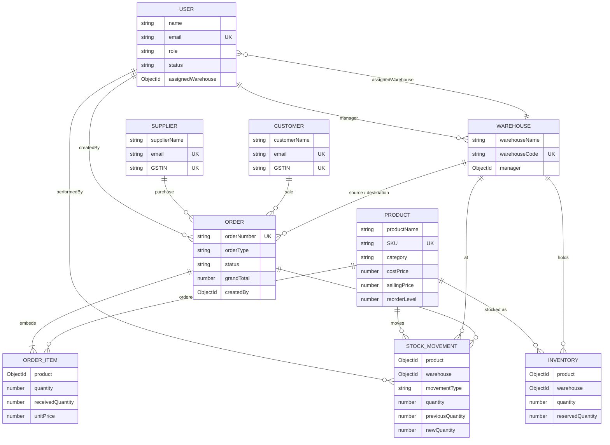

# StockFlow - Inventory & Warehouse Management System

StockFlow is a MERN-stack inventory and warehouse management system built as a DBMS course project. The focus is **database design and data integrity**: a normalised 8-model MongoDB schema, ACID multi-document transactions for every stock change, an immutable stock ledger, role-based access control enforced on the API, and aggregation-pipeline analytics.

---

## 1. Features

- **Master data CRUD** - products, suppliers, customers, warehouses, users (Admin only), with server-side search, filters, sorting, pagination, detail views, validation and delete protection.
- **Unified order model** for **purchases, sales and warehouse transfers**, each with its own status machine validated on the backend.
- **Transactional inventory logic**
  - Purchases update stock only on **receipt** (partial receiving supported).
  - Sales **reserve** stock on confirmation, **deduct** it on shipment, **release** it on cancellation.
  - Transfers move stock source -> destination with `Transfer Out` / `Transfer In` ledger entries.
  - Manual **adjustments** require a reason and record previous/new quantity.
- **Immutable stock ledger** (`StockMovement`) - created automatically, read-only through API and blocked at the model level.
- **Guards against**: negative stock, overselling, invalid reservations, double receiving, duplicate processing, inconsistent transfers, concurrent requests.
- **Analytics** - dashboard and 7 reports built with MongoDB aggregation pipelines (`$match $group $lookup $unwind $project $sort $facet ...`), with CSV export.
- **Auth** - JWT, bcrypt, registration, login, profile, change password, backend RBAC (Admin / Inventory Manager / Staff).
- **Security** - Helmet, CORS, rate limiting, Joi validation, NoSQL-operator sanitisation, centralised error handling.
- **Professional UI** - collapsible sidebar, breadcrumbs, global search, low-stock notifications, data tables, dynamic order forms, charts.

## 2. Tech stack

| Layer | Technology |
|---|---|
| Frontend | React 18, Vite 5, JavaScript, Tailwind CSS 3, React Router 6, Axios, Lucide React, Recharts, React Hook Form |
| Backend | Node.js, Express 4, REST, Mongoose 8, JWT (`jsonwebtoken`), `bcrypt`, Joi, Helmet, CORS, `express-rate-limit` |
| Database | MongoDB 6+ (**replica set required** for transactions) |
| Testing | Jest, Supertest, `mongodb-memory-server` (in-memory replica set) |

## 3. Architecture

```
React SPA  --HTTP/JSON-->  Express routes --> middleware (auth, RBAC, validate, sanitize, rate-limit)
                                |
                           controllers  (HTTP only)
                                |
                            services    (business rules, transactions)  <-- inventory.service / orderWorkflow.service
                                |
                          Mongoose models  -->  MongoDB replica set
```

- **Models** define schemas, indexes and invariants. **Controllers** only translate HTTP. **Services** hold all inventory/order business logic. **Middleware** handles authentication, permissions and errors. **Validators** (Joi) check every input.
- `crud.factory.js` generates the list/get/create/update/delete handlers for the simple entities so behaviour (search, pagination, errors) is identical everywhere.
- The frontend is data-driven: `ResourcePage` renders a full CRUD screen from a small config object; order screens are separate because of their workflow.

### Folder structure

```
.
├── backend/
│   ├── src/
│   │   ├── config/        env.js, db.js (connection + replica-set check)
│   │   ├── models/        User, Product, Supplier, Customer, Warehouse, Inventory, Order, StockMovement
│   │   ├── controllers/   auth, crud.factory, entities, inventory (+movements), order, report
│   │   ├── routes/        index.js (all route wiring + role matrix)
│   │   ├── services/      inventory.service, order.service, orderWorkflow.service, report.service
│   │   ├── middleware/    auth (JWT + RBAC), validate, sanitize, rateLimiter, errorHandler
│   │   ├── validators/    common, auth, entity, order, inventory (Joi schemas)
│   │   ├── utils/         ApiError, helpers, constants, jwt, transaction
│   │   ├── app.js         Express app (no listen -> testable)
│   │   └── server.js      connects to MongoDB, verifies replica set, listens
│   ├── scripts/           seed.js, start-replset.js, verify-consistency.js
│   └── tests/             auth, crud, workflow (+ helpers, global replica-set setup)
└── frontend/
    └── src/
        ├── api/           axios client + resource helpers
        ├── context/       AuthContext, ToastContext
        ├── hooks/         useList (server-side list state), useAsync
        ├── components/    ui/ (DataTable, Modal, Badge...), forms/, layout/, ResourcePage
        └── pages/         Dashboard, Products, Inventory, Warehouses, Suppliers, Customers,
                           orders/ (list, form, detail), StockMovements, Reports, Users, Settings, auth/
```

## 4. Database design

### 4.1 The 8 models

| Model | Key fields | Notes |
|---|---|---|
| **User** | name, email (unique), password (bcrypt, `select:false`), role, status, assignedWarehouse | roles: Admin, Inventory Manager, Staff |
| **Product** | productName, SKU (unique, upper-cased), description, category (**string**), brand, unit, costPrice, sellingPrice, reorderLevel, barcode (unique sparse), status | no Category model |
| **Supplier** | supplierName, contactPerson, email (unique sparse), phone, address, GSTIN (validated, unique sparse), status | |
| **Customer** | customerName, email, phone, address, GSTIN, status | |
| **Warehouse** | warehouseName, warehouseCode (unique), location, address, manager -> User, contactNumber, status | |
| **Inventory** | product -> Product, warehouse -> Warehouse, quantity, reservedQuantity, lastUpdated | unique `(product, warehouse)`; `available = quantity - reservedQuantity` (virtual) |
| **Order** | orderNumber (unique), orderType (`purchase`/`sale`/`transfer`), supplier?, customer?, sourceWarehouse?, destinationWarehouse?, `items[]` (product, quantity, receivedQuantity, unitPrice, subtotal), subtotal, tax, discount, grandTotal, status, orderDate, expectedDeliveryDate, notes, createdBy -> User | one model for all three flows; conditional requirements enforced in schema + Joi |
| **StockMovement** | product, warehouse, movementType, quantity (**signed**), previousQuantity, newQuantity, referenceOrder?, remarks, performedBy | immutable; invariant `new = previous + quantity` |

### 4.2 Relationships (ObjectId references)

- User 1-N Orders (`createdBy`), User 1-N StockMovements (`performedBy`), User 1-N Warehouses (`manager`)
- Product 1-N Inventory, Warehouse 1-N Inventory, **Product N-M Warehouse through Inventory** (junction collection with its own attributes)
- Supplier 1-N purchase Orders, Customer 1-N sales Orders, Warehouse 1-N Orders (source/destination)
- Product 1-N Orders through embedded `items` (order lines are embedded sub-documents - they have no life outside their order)
- Product 1-N StockMovements, Order 1-N StockMovements (`referenceOrder`)

### 4.3 ER diagram



### 4.4 Indexes

| Collection | Index | Purpose |
|---|---|---|
| users | `email` (unique); `{role,status}`; text(`name`,`email`) | login, filtering |
| products | `SKU` (unique); `barcode` (unique, sparse); `{category,status}`; `productName`; text(`productName`,`SKU`,`brand`) | duplicate prevention, filters, search |
| suppliers / customers | `email`, `GSTIN` (unique, sparse); name; text | duplicate prevention, search |
| warehouses | `warehouseCode` (unique); `warehouseName`; `manager`; text | |
| inventory | **`{product,warehouse}` (unique compound)**; `warehouse`; `quantity` | one row per product/warehouse, atomic upserts, per-warehouse listing |
| orders | `orderNumber` (unique); `{orderType,status,orderDate:-1}`; `{supplier,orderDate}`; `{customer,orderDate}`; `sourceWarehouse`; `destinationWarehouse`; `items.product` (multikey); `createdBy`; `orderDate` | list filters, reports, referential look-ups |
| stockmovements | `{product,warehouse,createdAt:-1}`; `{warehouse,createdAt}`; `{movementType,createdAt}`; `referenceOrder`; `performedBy`; `createdAt` | ledger filters, history |

Search uses case-insensitive, escaped regex on indexed name fields (so partial matches work); text indexes are declared as well for full-text use.

### 4.5 Integrity rules

- **Unique**: email, SKU, barcode, GSTIN, warehouseCode, orderNumber, `(product, warehouse)`.
- **Delete protection**: a product, supplier, customer, warehouse or user referenced by orders, ledger entries, stock or assignments cannot be deleted (HTTP 409) - **deactivate** it instead. Orders that touched stock are never deletable. Only Draft/Pending/Cancelled orders without ledger rows can be removed.
- **Schema validators** make illegal states unrepresentable: `quantity >= 0`, `reservedQuantity >= 0`, `reserved <= quantity`, integer quantities, status must belong to the order type, transfers need different warehouses, totals are recomputed server-side.
- **Ledger immutability**: `updateOne/updateMany/findOneAndUpdate/deleteOne/deleteMany/replaceOne/save-on-existing` all throw on `StockMovement`.

## 5. Business logic & transaction workflows

All stock changes run through `runInTransaction()` (`session.withTransaction`, snapshot read concern, majority write concern, automatic retry of transient errors). **There is no non-transactional fallback.**

Stock primitives (`inventory.service.js`) use **atomic conditional updates** - the safety condition is part of the filter, so two concurrent requests can never both pass the same check:

```js
// removeStock: succeeds only if enough UNRESERVED stock exists, otherwise matches nothing -> 409
Inventory.findOneAndUpdate(
  { product, warehouse, $expr: { $gte: [{ $subtract: ['$quantity', '$reservedQuantity'] }, qty] } },
  { $inc: { quantity: -qty } }, { new: true, session })
```

Order status changes use an atomic **compare-and-set** (`findOneAndUpdate({_id, status: {$in: allowedFrom}}, {$set: {status: to}})`). A second/duplicate request finds the status already changed and gets HTTP 409, so an order can never be received, shipped or completed twice.

### Status machines

| Type | Flow | Stock effect |
|---|---|---|
| Purchase | Draft -> **Ordered** -> **Partially Received** -> **Received**; Cancel from Draft/Ordered | `+qty` per receipt, `Purchase` movement; per-line guard `received + qty <= ordered` |
| Sale | Draft -> **Confirmed** -> Processing -> **Shipped** -> Delivered; Cancel from Draft/Confirmed/Processing | Confirm: `reserved += qty` (fails if not available). Ship: `quantity -= qty` and `reserved -= qty`, `Sale` movement. Cancel: `reserved -= qty` |
| Transfer | Pending -> **In Transit** -> **Completed**; Cancel from Pending/In Transit | Dispatch: source `-qty`, `Transfer Out`. Complete: destination `+qty`, `Transfer In` (a Pending transfer can be completed in one step = both). Cancel in transit: stock back to source, `Return` movement |
| Adjustment | increase / decrease + mandatory reason | `Adjustment` movement with previous/new quantity; cannot reduce below reserved units |

Rollback proof: the test-suite forces the ledger insert to fail *after* inventory and order rows were written and asserts that **every** write is rolled back and the same request succeeds afterwards.

### Standalone MongoDB

Transactions only work on a replica set. If the API is started against a standalone `mongod` it **refuses to start** and prints the fix (it never silently skips transactions). See section 7.

## 6. Roles & permissions (enforced in the API)

| Capability | Admin | Inventory Manager | Staff |
|---|:--:|:--:|:--:|
| Users CRUD | yes | - | - |
| Products / Warehouses: read | yes | yes | yes |
| Products / Warehouses: create, edit, delete | yes | yes | - |
| Suppliers: read & manage | yes | yes | - |
| Customers: read / create | yes | yes | yes |
| Customers: edit / delete | yes | yes | - |
| Inventory: read | yes | yes | yes |
| Inventory adjustments | yes | yes | - |
| Purchase orders & transfers | yes | yes | - |
| Sales orders (create, confirm, ship, deliver, cancel) | yes | yes | yes |
| Stock movements ledger | yes | yes | - |
| Dashboard | yes | yes | yes |
| Reports (all 7) | yes | yes | - |

Staff only ever see sales orders (list/detail are filtered on the server). Public registration always creates a **Staff** account.

## 7. MongoDB setup (replica set)

StockFlow **requires a replica set**.

**Option A - one command (recommended for local dev).** Starts a separate single-node replica set on port `27018` (data in `backend/.data/rs0`) without touching an existing standalone install:

```bash
cd backend
npm run db:replset
```

then use `MONGODB_URI=mongodb://127.0.0.1:27018/stockflow?replicaSet=rs0` (this is the default in `.env.example`). The script looks for `mongod` in `C:/Program Files/MongoDB/Server/*/bin`, then on `PATH`; override with `MONGOD_PATH`. Run it again after a reboot (it is idempotent).

**Option B - convert your existing mongod.** Add to `mongod.cfg`:

```yaml
replication:
  replSetName: rs0
```

restart `mongod`, run `rs.initiate()` once in `mongosh`, and use `mongodb://127.0.0.1:27017/stockflow?replicaSet=rs0`.

**Option C - MongoDB Atlas.** Atlas clusters are replica sets; paste the connection string into `MONGODB_URI`.

## 8. Environment variables (`backend/.env`)

| Variable | Default | Description |
|---|---|---|
| `PORT` | `5000` | API port |
| `NODE_ENV` | `development` | `production` hides internal error details |
| `CLIENT_URL` | `http://localhost:5173` | allowed CORS origin(s), comma separated |
| `MONGODB_URI` | `mongodb://127.0.0.1:27018/stockflow?replicaSet=rs0` | must point at a replica set |
| `REQUIRE_REPLICA_SET` | `true` | startup check; leave on |
| `JWT_SECRET` | *(required)* | startup fails if missing; generate with `node -e "console.log(require('crypto').randomBytes(48).toString('hex'))"` |
| `JWT_EXPIRES_IN` | `7d` | token lifetime |
| `BCRYPT_ROUNDS` | `10` | bcrypt cost factor |

Frontend (optional): `VITE_API_URL` (default `/api`, proxied by Vite to `http://localhost:5000`; override the proxy target with `VITE_API_PROXY`).

## 9. Installation & running

Prerequisites: Node.js 18+ and MongoDB 6+ installed.

```bash
# 1. backend
cd backend
npm install
cp .env.example .env          # then set JWT_SECRET (see table above)
npm run db:replset            # start the local replica set (once per boot)
npm run seed                  # demo data (wipes the database!)
npm run dev                   # API on http://localhost:5000

# 2. frontend (new terminal)
cd frontend
npm install
npm run dev                   # UI on http://localhost:5173
```

Production build: `cd frontend && npm run build` (output in `frontend/dist`). Health check: `GET /api/health`.

## 10. Seed data & demo credentials

`npm run seed` wipes the database and rebuilds it **by calling the real services** (so inventory, reservations and the ledger are consistent by construction), then runs `verify-consistency`. It creates 6 users, 3 warehouses, 18 products, 5 suppliers, 10 customers, 46 inventory rows, 30 orders (purchases in every status, sales Draft -> Delivered/Cancelled, completed / in-transit / pending transfers) and 85 stock movements. Four products are deliberately below their reorder level.

| Role | Email | Password |
|---|---|---|
| Admin | `admin@stockflow.com` | `Admin@123` |
| Inventory Manager | `manager1@stockflow.com`, `manager2@stockflow.com` | `Manager@123` |
| Staff | `staff1@stockflow.com`, `staff2@stockflow.com`, `staff3@stockflow.com` | `Staff@123` |

(The login page has one-click buttons that fill these in.) Seed refuses to run when `NODE_ENV=production` unless `--force`.

`npm run verify` re-checks the invariants at any time: ledger sum == inventory quantity, reserved == open sales orders, `0 <= reserved <= quantity`, `new = previous + quantity`.

## 11. Testing

```bash
cd backend
npm test
```

Runs Jest + Supertest against an **in-memory MongoDB replica set** (`mongodb-memory-server`). It uses your installed `mongod` on Windows (`C:/Program Files/MongoDB/Server/8.0`), otherwise set `MONGOMS_SYSTEM_BINARY=/path/to/mongod` or let it download one on first run.

**45 tests across 3 suites** - last run: `Test Suites: 3 passed, Tests: 45 passed`.

| Area | Covered |
|---|---|
| Authentication | register (role forced to Staff, no password leak), duplicate email, weak password, bcrypt hash, generic login errors, protected routes, deactivated users, profile, change password, NoSQL-injection |
| Authorization | role matrix on users, products, suppliers, movements, reports, adjustments, purchase/transfer vs sales access |
| CRUD | products, suppliers, customers, warehouses, users, orders (create/read/update/delete), search/filter/sort/pagination, delete protection, self-lockout protection |
| Duplicates | SKU (case-insensitive), supplier email, warehouse code, user email, inventory `(product,warehouse)` |
| Adjustments | increase/decrease, mandatory reason, ledger previous/new, negative stock, reserved units |
| Purchases | stock only on receipt, partial receiving, over-receiving, double receiving, concurrent duplicate receipts |
| Sales | stock validation, reservation, no overselling, ship deducts, cancel releases, no double release, concurrent confirmations |
| Transfers | atomic move, ledger pair, in-transit flow, cancel returns stock, insufficient source stock, reserved stock protected |
| Transactions | forced failure after writes -> full rollback for receive, ship and transfer, then successful retry |
| Reports | dashboard stats and every aggregation checked against known data |

## 12. API reference

Base URL `http://localhost:5000/api`. Auth: `Authorization: Bearer <token>`. Responses:

```json
{ "success": true, "data": {}, "message": "optional", "pagination": { "total": 40, "page": 1, "limit": 10, "totalPages": 4, "hasNext": true, "hasPrev": false } }
{ "success": false, "message": "First error", "errors": [{ "field": "SKU", "message": "SKU already exists" }] }
```

Status codes: 200/201 ok, 400 validation, 401 unauthenticated, 403 forbidden, 404 not found, 409 conflict (duplicate / insufficient stock / illegal transition / referenced record), 429 rate-limited.

List endpoints accept `page`, `limit` (max 100), `search`, `sortBy`, `order=asc|desc` plus resource filters.

### Auth
| Method | Path | Notes |
|---|---|---|
| POST | `/auth/register` | `{name,email,password}` -> Staff |
| POST | `/auth/login` | `{email,password}` -> `{token,user}` |
| GET | `/auth/me` | current user |
| PUT | `/auth/profile` | `{name?,email?}` |
| PUT | `/auth/change-password` | `{currentPassword,newPassword}` |

Logout is client-side (the JWT is discarded); tokens are stateless and expire after `JWT_EXPIRES_IN`.

### CRUD resources (`GET /`, `POST /`, `GET /:id`, `PUT /:id`, `DELETE /:id`)
| Path | Filters | Sort |
|---|---|---|
| `/products` (+ `GET /products/categories`) | `category`, `status`, `brand`, `search` | `productName, SKU, sellingPrice, costPrice, category, createdAt` |
| `/suppliers` | `status`, `search` | `supplierName, createdAt` |
| `/customers` | `status`, `search` | `customerName, createdAt` |
| `/warehouses` | `status`, `search` | `warehouseName, warehouseCode, createdAt` |
| `/users` (Admin) | `role`, `status`, `search` | `name, email, role, createdAt` |

### Inventory
| Method | Path | Notes |
|---|---|---|
| GET | `/inventory` | `warehouse, product, category, stockStatus=in-stock|low-stock|out-of-stock, lowStock=true, search`; sort `productName, SKU, quantity, availableQuantity, lastUpdated, warehouseName` |
| GET | `/inventory/:id` | |
| GET | `/inventory/warehouse/:warehouseId` | |
| GET | `/inventory/product/:productId` | |
| POST | `/inventory/adjustments` | `{product,warehouse,type:'increase'|'decrease',quantity,reason}` (Admin, Manager) |

### Orders
| Method | Path | Transition |
|---|---|---|
| GET | `/orders` | `orderType, status, supplier, customer, warehouse, from, to, search` (searches order number, supplier, customer, warehouse names); sort `orderDate, grandTotal, orderNumber, createdAt, status` |
| GET | `/orders/:id` | populated |
| POST | `/orders` | `{orderType, supplier/customer/sourceWarehouse/destinationWarehouse, items:[{product,quantity,unitPrice?}], tax, discount, orderDate, expectedDeliveryDate, notes}` |
| PUT | `/orders/:id` | only Draft (purchase/sale) or Pending (transfer) |
| DELETE | `/orders/:id` | Draft / Pending / Cancelled with no ledger rows |
| PATCH | `/orders/:id/confirm` | purchase Draft->Ordered; sale Draft->Confirmed + reserve |
| PATCH | `/orders/:id/process` | sale Confirmed->Processing |
| PATCH | `/orders/:id/receive` | purchase; `{items:[{itemId,quantity}], remarks?}` |
| PATCH | `/orders/:id/ship` | sale -> Shipped (deduct); transfer Pending -> In Transit (deduct source) |
| PATCH | `/orders/:id/deliver` | sale Shipped->Delivered |
| PATCH | `/orders/:id/complete-transfer` | transfer -> Completed (credit destination) |
| PATCH | `/orders/:id/cancel` | `{remarks?}`; releases reservation / returns in-transit stock |

### Stock movements (Admin, Manager; read-only)
`GET /stock-movements` (`product, warehouse, movementType, referenceOrder, from, to, search`; sort `createdAt, quantity`), `GET /stock-movements/:id`. There are intentionally no POST/PUT/DELETE routes.

### Reports (Admin, Manager; dashboard for all roles)
`GET /reports/dashboard`, `/reports/inventory`, `/reports/purchases`, `/reports/sales`, `/reports/low-stock`, `/reports/warehouse`, `/reports/valuation`, plus `/reports/stock-movements` (movement summary). Purchase/sales/movement reports accept `from` and `to`.

## 13. Aggregation queries (important ones)

All live in `backend/src/services/report.service.js` and `inventory.service.js`.

**1. Total inventory per warehouse** - `$group` + `$lookup` + `$unwind` + `$project`
```js
Inventory.aggregate([
  { $group: { _id: '$warehouse', totalUnits: { $sum: '$quantity' }, reservedUnits: { $sum: '$reservedQuantity' },
              productCount: { $sum: { $cond: [{ $gt: ['$quantity', 0] }, 1, 0] } } } },
  { $lookup: { from: 'warehouses', localField: '_id', foreignField: '_id', as: 'warehouse' } },
  { $unwind: '$warehouse' },
  { $project: { warehouseName: '$warehouse.warehouseName', totalUnits: 1, reservedUnits: 1,
                availableUnits: { $subtract: ['$totalUnits', '$reservedUnits'] }, productCount: 1 } },
  { $sort: { totalUnits: -1 } } ])
```

**2. Product-wise stock across warehouses** - `$group` + `$push`, then `$lookup` for names (`inventoryReport`), paginated with `$facet`.

**3. Low-stock products** - starts from `Product` so products with *no* inventory rows (zero stock) are included
```js
Product.aggregate([
  { $match: { status: 'Active' } },
  { $lookup: { from: 'inventories', localField: '_id', foreignField: 'product', as: 'stock' } },
  { $addFields: { totalQuantity: { $sum: '$stock.quantity' } } },
  { $match: { $expr: { $lte: ['$totalQuantity', '$reorderLevel'] } } },
  { $sort: { shortfall: -1 } } ])
```

**4 & 5. Monthly purchase / sales totals** - `$match` (type, counted statuses, date) -> `$group` by `{ $year, $month }` of `orderDate` -> `$sort`; gaps filled with zero months.

**6. Category-wise inventory** - `$lookup` product -> `$group` by `product.category` with `$sum` of units, cost and retail value, `$addToSet` of products.

**7. Inventory valuation** - `$lookup` product + warehouse, `$addFields` `quantity * costPrice` / `quantity * sellingPrice`, then a single `$facet` producing totals, by-warehouse, by-category, by-product.

**8. Supplier-wise purchases / 9. Customer-wise sales** - `$match` counted orders -> `$group` by `$supplier` / `$customer` -> `$lookup` -> `$unwind` -> `$sort`. Top products use `$unwind: '$items'` then `$group`.

**10. Stock movement summaries** - `$group` by `movementType` (and by warehouse) with conditional sums for units in (`quantity > 0`) and out (`quantity < 0`).

**Inventory list** uses `$lookup` x2, `$unwind`, `$addFields` (available quantity and an in/low/out-of-stock `$switch`), `$match` on the computed status, and `$facet` (`data` + `$count`) for server-side pagination in one round trip.

## 14. DBMS concepts demonstrated

- **Normalisation & modelling**: master data in separate collections, references instead of duplication, embedded order lines (aggregate root), junction collection (`Inventory`) for the M:N product<->warehouse relationship, a single polymorphic `Order` collection with conditional constraints.
- **Entity integrity**: unique and compound-unique indexes (`SKU`, `(product, warehouse)`), sparse unique indexes for optional keys.
- **Referential integrity** (not enforced natively by MongoDB): service-level existence checks on write, `RESTRICT`-style delete protection, deactivation instead of deletion.
- **Domain integrity**: schema validators, enums, min/integer constraints, cross-field rules (`reserved <= quantity`, source != destination).
- **ACID transactions**: multi-document, snapshot isolation, automatic retry of `TransientTransactionError`, all-or-nothing rollback.
- **Concurrency control**: optimistic atomic compare-and-set status changes and conditional `$inc` updates (guard in the filter), verified with concurrent-request tests.
- **Audit trail**: append-only ledger whose running balance reconstructs the inventory (`SUM(quantity) == Inventory.quantity`).
- **Indexing & query optimisation**: compound indexes aligned to filter+sort, multikey index on `items.product`, `$facet` pagination, server-side everything.
- **Aggregation framework**: relational-style joins (`$lookup`), grouping, conditional sums, multi-result pipelines.

## 15. Design decisions & assumptions

- `StockMovement.quantity` is **signed** (+in / -out) so a ledger sum equals the on-hand quantity.
- Reserving stock is *not* a stock movement (on-hand does not change); the `Sale` movement is created on shipment.
- A transfer cancelled while In Transit returns stock via a `Return` movement.
- **Low stock** is evaluated per **product** (total across warehouses <= reorder level) on the dashboard and the Low stock report. The Inventory page and the header notification bell use a per-**warehouse-row** status (available <= reorder level), so their counts can be higher than the product-level count.
- Tax and discount are absolute amounts (INR); `grandTotal = subtotal + tax - discount` is recomputed on the server.
- Extra endpoints beyond the brief, each necessary: `PATCH /orders/:id/process` (the Processing status), `GET /products/categories` (category filter without a Category model), `GET /reports/stock-movements` (aggregation #10).
- Reports other than the dashboard are limited to Admin and Inventory Manager.
- Dropdowns on the order forms load up to 100 active suppliers/customers/warehouses; product selection is an async server-side type-ahead.

## 16. Task checklist

**Completed**
- [x] Phase 1 - Architecture, 8 schemas, relationships, indexes, validation, ER diagram, business rules
- [x] Phase 2 - Express + MongoDB setup, models, auth, middleware, error handling
- [x] Phase 3 - CRUD APIs with search/filter/sort/pagination for all entities
- [x] Phase 4 - Purchases, sales, reservations, transfers, adjustments, ledger, transactions
- [x] Phase 5 - Aggregations, dashboard, 7 reports (+ movement summary)
- [x] Phase 6 - Frontend: layout, auth, all module pages, reusable components, API integration
- [x] Phase 7 - 45 automated tests passing, UI flows exercised in a browser against the seeded replica set
- [x] Phase 8 - README, seed data, setup scripts, consistency verifier

**Known limitations / possible extensions**
- No automated browser (E2E) test suite; the UI was verified manually (login, dashboard, products, inventory, sales order create -> confirm, receive dialog, all report tabs).
- JWT logout is client-side only (no token revocation list).
- Assigned warehouses on users are informational; they do not restrict which warehouses a user may operate on.
- Notifications are low-stock alerts only (polled every 2 minutes).
